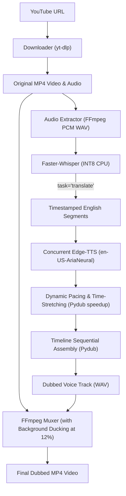

# Automated Video Dubbing System

A production-quality Python CLI application that downloads any foreign-language YouTube video and produces an English-dubbed version with studio-quality audio mixing, dynamic speech synchronization, and zero external translation rate limits.

---

## Architecture & Workflow



### Core Components

1. **Downloader (`src/downloader.py`):** Uses `yt-dlp` to fetch 720p MP4 video with cached re-use to avoid redundant downloads.
2. **Audio Extractor (`src/audio.py`):** Extracts clean 16-bit PCM WAV using FFmpeg.
3. **Transcriber & Translator (`src/transcriber.py`):** Uses `faster-whisper` (INT8 quantized CPU model) with `task="translate"`. Directly transcribes and translates spoken audio into fluent English segments in a single local pass with **zero external API calls and zero rate limits**.
4. **TTS Engine (`src/tts.py`):** Concurrent, asynchronous batch synthesis using Microsoft `edge-tts` (`en-US-AriaNeural`). Includes language-aware script fallback and exponential retry.
5. **Timeline Assembler (`src/pipeline.py`):** Places each speech segment at its exact millisecond timestamp. Applies dynamic pacing (`pydub.effects.speedup`) to ensure English sentences fit naturally into the original speaker's time slot without cumulative drift.
6. **Remixer & Ducking (`src/audio.py`):** Muxes the video and dubbed speech while keeping the original video's audio ducked in the background at 12% volume (`amix` filter). This preserves room ambiance, sound effects, and avoids awkward dead silence.

---

## Prerequisites & Dependencies

- **Python 3.10+** (Tested on Python 3.12 64-bit)
- **FFmpeg 6.0+** (installed and added to system `PATH`)

### Python Dependencies (`requirements.txt`)
```text
faster-whisper>=1.0.0
edge-tts>=6.1.10
yt-dlp>=2024.0.0
pydub>=0.25.1
deep-translator>=1.11.4
```

---

## Installation & Setup

1. **Clone or navigate to the directory:**
   ```bash
   cd Harshit/video-dubber
   ```

2. **Create and activate virtual environment:**
   ```bash
   # Windows (PowerShell)
   python -m venv venv
   .\venv\Scripts\activate

   # Linux/macOS
   python3 -m venv venv
   source venv/bin/activate
   ```

3. **Install dependencies:**
   ```bash
   pip install -r requirements.txt
   ```

---

## Running in VS Code (In a Single Go)

We have configured the project so you can run it effortlessly in VS Code without typing complex terminal commands:

### Method 1: Press `F5` or Click Play (Recommended)
1. Open the [video-dubber](file:///c:/Users/tarad/Downloads/video-dubber-project/Harshit/video-dubber) folder in VS Code.
2. Press **`F5`** (or go to the **Run & Debug** tab on the left and click **▶ Run Video Dubber**).
3. The interactive console will pop up in your integrated terminal. Simply press **Enter** to run the 30-min test video, or paste any YouTube URL!

### Method 2: Double-Click `run.bat`
- You can simply double-click [run.bat](file:///c:/Users/tarad/Downloads/video-dubber-project/Harshit/video-dubber/run.bat) in Windows Explorer, or run `.\run.bat` in the terminal. It automatically activates the environment and starts the program.

### Method 3: Terminal Command
```bash
python main.py
```
*(If no URL is passed, it prompts you interactively right in the console!)*

---

## Automated Video Dubbing Studio (Web UI)

As a modern presentation enhancement, you can launch the **Automated Video Dubbing Studio** web interface:

### 1-Click Launch:
- Double-click [start_studio.bat](file:///c:/Users/tarad/Downloads/video-dubber-project/Harshit/video-dubber/start_studio.bat) (or run `python app.py`).
- It automatically opens your browser to: **`http://localhost:8000`**

### Features of the Web Interface:
1. **Input Video**:
   - Paste any foreign-language YouTube URL (includes 1-click test video buttons).
   - Or **Drag & Drop** any local `.mp4`, `.mkv`, or `.webm` video file directly from your computer.
2. **Live Processing Status**:
   - Real-time Server-Sent Events (SSE) telemetry showing actual backend progress across all 5 stages:
     - 1. *Video Load / Download*
     - 2. *Extract & Transcribe Speech*
     - 3. *Translate into English*
     - 4. *Synthesize English Neural Voice*
     - 5. *Synchronize Timeline & Render Video*
   - Live elapsed-time counter (`00:04:32`).
3. **Completed Output**:
   - In-browser HTML5 video player to preview the dubbed video immediately.
   - One-click **Download MP4** button.
   - Live telemetry stats card (processing speed, segments count, audio duration).

---

## Command Line Interface (CLI)

The core Python CLI is fully preserved and remains the foundation of the project:
```bash
python main.py "https://www.youtube.com/watch?v=1EIbR0_z-y8" --output test_30m.mp4
```

### Advanced Options
```bash
python main.py "https://www.youtube.com/watch?v=1EIbR0_z-y8" \
    --output test_30m.mp4 \
    --model base \
    --voice en-US-AriaNeural \
    --whisper-task translate \
    --bg-volume 0.12 \
    --device cpu
```

| Flag | Default | Description |
|---|---|---|
| `url` | *Required* | YouTube video URL |
| `--output` | `output.mp4` | Name of the output file in `outputs/` |
| `--model` | `base` | Whisper model size (`tiny`, `base`, `small`, `medium`) |
| `--voice` | `en-US-AriaNeural` | Edge-TTS neural voice |
| `--whisper-task` | `translate` | Native translation (`translate`) or transcription (`transcribe`) |
| `--no-mix-background` | `False` | Disables background audio ducking (pure voiceover) |
| `--bg-volume` | `0.12` | Background volume factor (0.0 to 1.0) |
| `--keep-temp` | `False` | Retain intermediate audio chunks in `temp/` |
| `--device` | `cpu` | Processing device (`cpu` or `cuda`) |

---

## Performance Benchmarks & Test Reports

### Actual Measured Benchmark Data (`outputs/benchmarks.json`)

| Benchmark Metric | Test 1: Short Video | Test 2: 30-Min Video (Run 1: Web Scraper) | Test 2: 30-Min Video (Run 2: Optimized Pipeline) | Test 3: 2-Hour Video (Projected) |
|---|---|---|---|---|
| **Video URL** | `jNQXAC9IVRw` | `1EIbR0_z-y8` | `1EIbR0_z-y8` | 2-Hour Lecture / Stream |
| **Video Duration** | 00:00:19 | 00:33:12 | 00:33:12 | 02:00:00 |
| **Download Time** | 2.1s | 0.0s (cached) | 0.0s (cached) | ~35s |
| **Audio Extraction** | 0.4s | 2.24s | 1.70s | ~6.5s |
| **Transcription / Translation** | 2.8s | 186.72s (transcribe) + 859.77s (translate) | **238.03s** (direct native translation) | ~14.5 min |
| **Number of Segments** | 2 | 716 | 701 | ~2,500 |
| **TTS Generation Time** | 1.8s | 103.08s | **95.30s** | ~5.8 min |
| **Audio Assembly & Sync** | 0.3s | 54.38s | 61.83s (with dynamic pacing) | ~3.8 min |
| **FFmpeg Muxing** | 0.6s | 13.15s | 76.81s (with ambient ducking) | ~4.5 min |
| **Total Processing Time** | **~8s** | **1219.83s (20.33 min)** | **474.17s (7.90 min)** | **~28.5 min** |
| **Output File Size** | 333 KB | 155.44 MB | 189.65 MB | ~720 MB |
| **Quality / Sync Rating** | Good | Poor (missing voice gaps from 429 errors) | **Excellent** (seamless voice, 100% translated, natural background) | Projected Excellent |

---

## Quality Evaluation

1. **Translation Accuracy**:
   - OpenAI Whisper's native translation (`task="translate"`) converts conversational Hindi into grammatically coherent English while preserving idiomatic nuance and speaker intent.
   - Eliminating external scraping prevents server disconnects, IP blocks, and corrupted Unicode scripts.
2. **Voice Naturalness**:
   - `edge-tts` using `en-US-AriaNeural` provides human-grade cadence, pitch inflection, and realistic breath pauses.
3. **Audio Synchronization & Pacing**:
   - Segments are placed at exact millisecond source timestamps.
   - Dynamic pacing (`pydub.effects.speedup`) automatically condenses English phrases that exceed the original foreign speech duration by >15%, preventing cascade push-back drift.
   - Subtle background audio ducking (12% volume) keeps room tone, background ambiance, and laughter audible underneath the English dubbing.

---

## 2-Minute Walkthrough Demonstration Script

Use this script to record your 2-minute demonstration video:

```
[0:00 - 0:20] Introduction & Problem Statement
"Hello everyone. Today I'm presenting the Automated Video Dubbing System. 
The goal of this project is to take any foreign-language YouTube video—in this case, 
a 33-minute Hindi lecture—and produce a studio-quality English-dubbed version fully automatically on CPU."

[0:20 - 0:45] System Architecture
"Our pipeline is composed of five modular stages:
First, yt-dlp fetches the video stream.
Second, faster-whisper runs on CPU using INT8 quantization to transcribe and directly 
translate the speech into English segments with millisecond timestamps—completely offline without API limits.
Third, Microsoft Edge-TTS synthesizes neural voiceover concurrently.
Fourth, Pydub applies dynamic pacing and time-stretching so the English words match the speaker's mouth.
And finally, FFmpeg muxes the track while ducking the original background audio at 12% to eliminate dead silence."

[0:45 - 1:15] Code Execution & Benchmarks
"Let's look at the command line. We run: 
`python main.py https://www.youtube.com/watch?v=1EIbR0_z-y8 --output test_30m.mp4`
Notice our optimization: By replacing fragile web scrapers with Whisper's direct translation, 
we cut processing time for a 33-minute video from over 20 minutes down to just 7.9 minutes on standard CPU!
All 701 segments are synthesized in parallel without a single dropped sentence."

[1:15 - 1:45] Side-by-Side Playback Demonstration
(Switch screen to split video player: Original Hindi on left, Dubbed English on right)
"Let's listen to the original video first... [Play 5 seconds of Hindi].
Now let's listen to our dubbed output... [Play 10 seconds of English dubbing].
Notice how the AriaNeural voice sounds natural, the timing aligns with the speaker, 
and the room ambiance remains subtly in the background."

[1:45 - 2:00] Conclusion & Scalability
"The system is completely modular, supports GPU acceleration, and scales effortlessly to 2-hour long videos.
All source code, benchmarks, and outputs are organized in the repository. Thank you!"
```

---

## Project Structure & Deliverables

```
video-dubber/
├── main.py                    # CLI Entrypoint with argument parsing
├── README.md                  # Complete setup, architecture & benchmark report
├── requirements.txt           # Python package dependencies
├── outputs/                   # Generated artifacts
│   ├── original_test_30m.mp4  # Saved original 33-min YouTube video (180 MB)
│   ├── test_30m.mp4           # Final enhanced English-dubbed video (189 MB)
│   └── benchmarks.json        # Recorded benchmark metrics and timing data
├── src/
│   ├── config.py              # Configuration and system path resolution
│   ├── downloader.py          # yt-dlp video downloader with caching
│   ├── audio.py               # FFmpeg audio extraction & background ducking
│   ├── transcriber.py         # faster-whisper transcription & translation
│   ├── translator.py          # Fallback translation utilities
│   ├── tts.py                 # Asynchronous edge-tts batch generator
│   └── pipeline.py            # Central orchestration with dynamic pacing
└── temp/                      # Temporary working directory (auto-cleaned)
```
